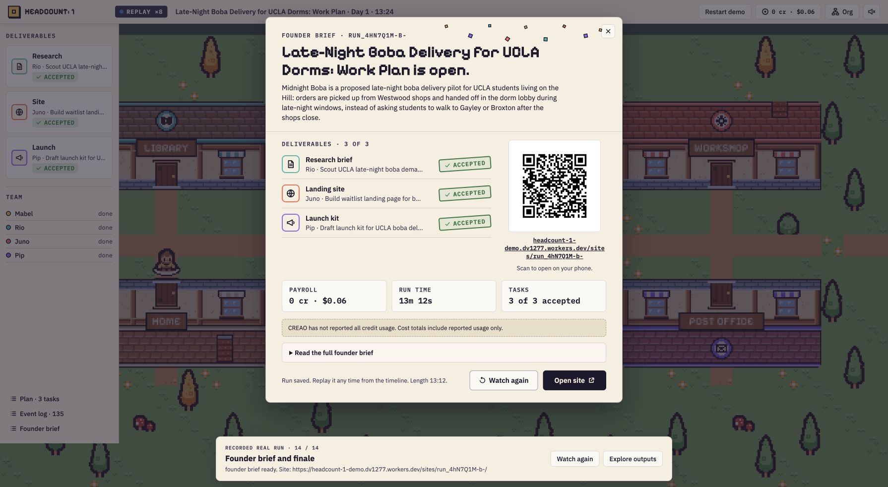

# Headcount: 1

### A company of one, in good company.

Headcount: 1 turns a business idea into coordinated work you can follow. Approve a plan, watch your AI team research and build, and open the finished work from a town where every department has a place.

**[Explore the interactive demo](https://headcount-1-demo.dv1277.workers.dev/demo)** · **[Open a generated site](https://headcount-1-demo.dv1277.workers.dev/sites/run_4hN7Q1M-b-/)** · **[Explore the design](https://app.paper.design/file/01M579A4RA58NP21Q5HRB94MVA/p-2-0)**



## Your company at work

Give the Mayor an idea, such as “Late-night boba delivery for UCLA dorms.” Mabel prepares a plan with clear owners, instructions and dependencies. Edit the scope and approve it before work begins.

Rio researches the market first. Once that research is ready, Juno builds the landing page and Pip prepares the launch copy in parallel. Envelopes carry the research between buildings; completed work arrives at City Hall for review. You can inspect each agent, pause execution, or redirect a department with a note.

The finished workspace contains a research brief with source links, a generated landing page, social posts, outreach copy and a founder brief with next steps. Open the page directly or scan its QR code on another device.

| Resident | Responsibility | Execution |
|---|---|---|
| Mabel, Mayor | Planning, deliverable review and the founder brief | StepFun `step-5-preview` |
| Rio, Scout | Competitors, pricing, audiences and market gaps | Saved CREAO research agent |
| Juno, Maker | A self-contained landing page informed by research | Saved CREAO website agent |
| Pip, Herald | Social posts and outreach informed by research | Saved CREAO launch agent |

The founder controls the plan. Department agents do the work. The town makes ownership, dependencies and results visible throughout the process.

## Explore a complete run

The [public demo](https://headcount-1-demo.dv1277.workers.dev/demo) follows a completed execution from the starting prompt to the final QR. It switches between the town, plan, agent inspectors, research, org chart, event log and finished outputs. Pause, skip chapters, restart, or explore the deliverables at your own pace.

The boba company completed three department tasks with two research handoffs and four revisions in 13 minutes, 12 seconds. Its recording contains 135 events and seven artifacts, including earlier versions. The guided tour takes about three minutes; 20× playback takes about 40 seconds.

The public experience replays actual StepFun and CREAO execution. Its recording, fonts, artwork and generated site are hosted together on Cloudflare Workers. Viewing the demo starts no new agent runs. New executions use the Node service described below.

## How it works

The server executes a dependency graph after founder approval. StepFun handles the Mayor's decisions; CREAO runs the three saved department agents through API Trigger. Async status polling, request pacing and retry limits keep long-running work manageable. Polling retries continue observing the same external run, preventing duplicate dispatches.

Every state change enters an append-only JSONL log. A shared reducer builds the current state, and a cue mapper translates those events into Phaser movement, speech, handoffs and review stamps. The live interface consumes a resumable server-sent event stream. Replay uses the same reducer, so seeking reconstructs the recorded state without making model calls.

Generated HTML passes through an allowlist sanitizer and is served with a restrictive Content Security Policy. A separate site publisher keeps generated pages apart from the control API. Credentials remain on the server.

| Layer | Technology |
|---|---|
| Interface | React, TypeScript, Vite, Zustand |
| Town | Phaser, Paper artwork, Pixelify Sans, IBM Plex |
| Execution | Node.js, Express, StepFun, CREAO |
| Contracts and state | Zod, shared event schemas, pure reducer |
| Site delivery | Sanitized HTML, QR codes, Cloudflare Workers Static Assets |

## Run locally

Requires Node.js 22.9 or newer.

```sh
npm ci
npm run dev
```

Open **http://127.0.0.1:5173/demo** for the guided recording. It works without agent credentials or a running backend. `npm run demo` opens the faster 20× recording.

To start new companies, create a `.env` file in the repository root with the following configuration:

| Variable | Value |
|---|---|
| `STEPFUN_API_KEY` | Your StepFun API key |
| `STEPFUN_MODEL` | `step-5-preview` |
| `CREAO_API_MODE` | `app` |
| `CREAO_SCOUT_APP_ID` | Your saved research agent ID |
| `CREAO_MAKER_APP_ID` | Your saved website agent ID |
| `CREAO_HERALD_APP_ID` | Your saved launch agent ID |
| `CREAO_SCOUT_APP_KEY` | Research agent's API Trigger key |
| `CREAO_MAKER_APP_KEY` | Website agent's API Trigger key |
| `CREAO_HERALD_APP_KEY` | Launch agent's API Trigger key |
| `CREAO_APP_KEY` | Optional shared fallback, when the key is authorized for all three apps |
| `PUBLIC_BASE_URL` | Public origin serving the site publisher, for links that open on other devices |

Start the backend in a second terminal with `npm run dev:server`, then open **http://127.0.0.1:5173/**. The control API listens on `127.0.0.1:8787`, and the site publisher listens on `127.0.0.1:8788`. Route public site traffic to the site publisher. Keep the control API private.

### Agent workspaces

The company uses a saved agent for each department:

| Agent | Workspace | Agent ID |
|---|---|---|
| Scout, Rio | [Research](https://agent.creao.ai/apps/dabe17eb-3f2c-40d9-bc8c-662f8736ddc1) | `dabe17eb-3f2c-40d9-bc8c-662f8736ddc1` |
| Maker, Juno | [Website](https://agent.creao.ai/apps/2430f36c-51b1-484e-9025-8cb37837f0d9) | `2430f36c-51b1-484e-9025-8cb37837f0d9` |
| Herald, Pip | [Launch](https://agent.creao.ai/apps/bc76ea75-e5c8-4b83-a8b2-ff8722009881) | `bc76ea75-e5c8-4b83-a8b2-ff8722009881` |

[View Rio's completed research run](https://agent.creao.ai/share/f998fa478beda09a6d774b969133e192), whose output feeds both downstream departments. Agent instructions and input contracts live in [the server's worker module](apps/server/src/workers).

## Development and deployment

```sh
npm run typecheck       # TypeScript checks
npm test                # 223 tests across contracts, execution, replay and hosting
npm run smoke           # API, events, workers and site publishing with mock providers
npm run scan:secrets     # Credential-pattern scan
npm run build           # Web application
npm run dev:edge        # Cloudflare demo preview on port 8790
npm run deploy          # Build and publish the Cloudflare demo
```

The Cloudflare build hosts the recorded experience and its generated site. It does not host the live Node executor or receive agent credentials.

| Directory | Contents |
|---|---|
| `apps/web` | Town, HUD, artifact viewers and guided replay |
| `apps/server` | Approval flow, executor, provider adapters and site publisher |
| `apps/edge` | Cloudflare Worker and public routing |
| `packages/contracts` | Shared event, plan and artifact schemas |
| `packages/engine` | State reducer and animation cues |
| `fixtures/runs` | Recordings, artifact payloads and generated HTML |

## Design and data

The [Paper town](https://app.paper.design/file/01M579A4RA58NP21Q5HRB94MVA/p-2-0) and [HUD designs](https://app.paper.design/file/01M579A4RA58NP21Q5HRB94MVA/p-5-0) define the visual system. Exported artwork is assembled by [the asset build script](scripts/build-town-assets.py). Kenney CC0 assets provide the pixel-art foundation.

Research includes source links for review. Outreach copy is available to inspect and copy; the system does not send it automatically. The example site's signup form opens an email client and does not store submissions. Usage displays distinguish reported model costs from unavailable CREAO credit totals.

Keep `.env` files and API keys out of source control. Agent requests run through the backend; the browser renders events and artifacts.
